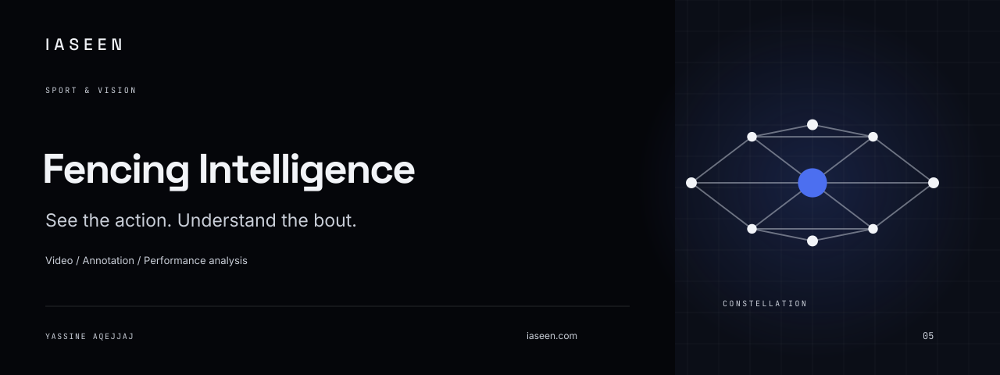
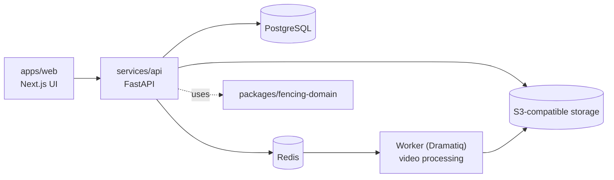

# Fencing Intelligence

<!-- portfolio-summary:start -->



> **Human-validated fencing video analysis** | **Status:** Experimental beta; detection heuristics are not validated refereeing.
>
> [Live application](https://fencing-intelligence.vercel.app) · [Architecture](README.md#run-locally) · [Demo / verification](README.md#what-you-can-do) · [Source code](https://github.com/yassineaqejjaj/fencing-intelligence)

[](https://github.com/yassineaqejjaj/fencing-intelligence/actions/workflows/ci.yml)

<!-- portfolio-summary:end -->


## Product overview

Self-hosted fencing video analysis for épée, foil, and sabre. Coaches and athletes upload video, annotate actions, record touches, and read statistics that come only from validated records.

The application is useful without a trained fencing model. Movement and scoreboard detectors are experimental heuristics. They do not claim recognition accuracy, and they do not decide referee priority.

**Status: Prototype / experimental beta.** All detection and coaching output in this repository is experimental and is not validated refereeing.

## The problem

Fencing video is hard to review systematically: actions, touches and scores usually live in a coach's head or in loose notes. Automatic detection is unreliable, and no model in this repository has been evaluated on real fencing video (see `docs/IMPLEMENTATION_STATUS.md`). Statistics built on unvalidated guesses would mislead.

## The solution

A human-validated workflow: a person marks actions, touches and scores on the video, and statistics are computed only from those validated records. Heuristic suggestions (movement, scoreboard lights) are optional, experimental and never change official scores by themselves. Empty states are shown explicitly until something is validated.

## Key features

### What you can do

- Create an account, a club, and athlete profiles.
- Upload a video, transcode it, and play it through a short-lived signed URL.
- Mark actions, touches, and scores.
- Read bout and athlete statistics, including explicit empty states when nothing is validated.
- Generate a PDF report and export JSON or CSV.
- Review dataset licenses with `datasets doctor`.

Also present in the code and docs (see `docs/IMPLEMENTATION_STATUS.md` and `docs/FEDERATION_ROADMAP.md`): organization and role checks, English and French navigation, guardian consent for minor athletes, licensed athlete identity with CSV import, and a federation pilot slice (competition entries, poule sheets, standings, direct-elimination draws, referee assignment). Experimental heuristics: pose estimation via MediaPipe and a logistic-regression baseline trained on synthetic data, which is a pipeline check and not fencing accuracy.

## Architecture

Monorepo, derived from the directory layout and `docker-compose.yml`:



Other directories: `services/video-worker`, `services/ml-inference`, `ml/`, `infrastructure/` (Dockerfiles, Caddyfile, Prometheus alerts), `scripts/` (backup and restore). Decisions are in `docs/DECISIONS.md`.

## Tech stack

- Backend: Python (3.11+ per `pyproject.toml`; 3.12 or 3.13 for local use), FastAPI, SQLAlchemy, Alembic, Pydantic, Dramatiq, ReportLab, boto3, structlog, OpenTelemetry, Prometheus instrumentation. Managed with uv.
- Frontend: Next.js 16, React 19, TypeScript, Vitest, Playwright.
- Data services: PostgreSQL, Redis, S3-compatible object storage (MinIO-style, via Docker Compose).
- Media: FFmpeg. Optional ML extras: numpy, scipy, scikit-learn, OpenCV.
- Deployment files: Docker Compose (dev and prod), Caddy, Railway config.

## Screenshots / Demo

Live application: https://fencing-intelligence.vercel.app (link taken from the summary block above; not verified here). No screenshots are in the repository; only the project cover:


## Getting started

### Run locally

Requirements: Docker, Python 3.12 or 3.13, [uv](https://docs.astral.sh/uv/), Node.js 22 or newer, pnpm, and FFmpeg with `ffprobe` on `PATH`.

```bash
docker compose up -d postgres redis minio
cd services/api
uv sync
uv run alembic upgrade head
INLINE_JOBS=true uv run uvicorn fencing_api.main:app --host 127.0.0.1 --port 8000
```

In another terminal:

```bash
cd apps/web
pnpm install
API_INTERNAL_URL=http://127.0.0.1:8000 pnpm dev
```

Open http://localhost:3000. If another program already uses port 8000 or 3000, start Uvicorn and `pnpm dev` on free ports and set `API_INTERNAL_URL` to the API. Copy `.env.example` when you change hosts or secrets. Development defaults are rejected when `ENVIRONMENT=production`.

`INLINE_JOBS=true` processes video inside the API process. Leave it false and run the worker for anything beyond a local session:

```bash
cd services/api
uv run python -m dramatiq fencing_api.tasks --processes 1 --threads 2
```

### Dataset check

```bash
cd services/api
uv run datasets doctor --root ../../data/datasets
```

External datasets are not downloaded. See `docs/LICENSES.md`.

## Testing & quality

```bash
cd services/api
uv run pytest tests ../../packages/fencing-domain/tests -q
cd ../../apps/web
pnpm exec tsc --noEmit
pnpm test
```

The Python suite needs the Compose services and FFmpeg. It creates the `fencing_test` database.

**CI currently fails.** The GitHub Actions workflow (`.github/workflows/ci.yml`, jobs `python` and `web`) reports a pytest collection error in `test_intelligence.py`. Note that two files with that name exist (`services/api/tests/` and `packages/fencing-domain/tests/`) and neither directory has an `__init__.py`; this is an observation, the cause has not been confirmed. This documentation-only change does not fix it, by design. The badge at the top reflects the live CI result.

Documented, dated results in `docs/IMPLEMENTATION_STATUS.md` (a local run, not a GitHub-hosted one, as that file itself states): API pytest suite, `tsc`, Vitest and Playwright journeys passed locally on the dates given there. CI also runs `pip-audit` and `pnpm audit`.

## Current status

Prototype. Experimental beta; detection heuristics are not validated refereeing. Per `docs/IMPLEMENTATION_STATUS.md`, the manual path (account, club, athlete, bout, upload, playback, annotation, touch, statistics, report, export) works locally; see that file for the verified and not-verified lists.

## Known limitations

- CI currently fails (see Testing & quality).
- No model has been evaluated on real fencing video; no recognition accuracy is claimed.
- Movement and scoreboard detection are experimental heuristics and never decide priority or official scores.
- Statistics stay empty until a person validates an annotation or touch.
- Distance stays in pixels until a piste calibration is saved.
- No load test; concurrent upload and transcode behaviour is unmeasured.
- External datasets are not downloaded; `datasets doctor` reports most as missing or incompatible.
- GitHub Actions has not been confirmed passing on a hosted runner (per `docs/IMPLEMENTATION_STATUS.md`).

## Roadmap

See `docs/ROADMAP.md` and `docs/FEDERATION_ROADMAP.md`. Next items listed there include a review queue for heuristic suggestions, Playwright coverage of phrase marking and calibration, a GitHub-hosted CI run, TLS and SMTP verification, a data-retention schedule, and evaluating pose estimation on fencing video.

## License

Original code is Apache-2.0. See `LICENSE` and `docs/LICENSES.md`.

---

## Part of an engineering approach

Built with the [Agentic SDLC framework](https://github.com/yassineaqejjaj/agentic-sdlc) (earned autonomy). Read how this project was built and what its checks caught in the [case study](https://github.com/yassineaqejjaj/agentic-sdlc/blob/main/docs/case-studies/fencing-intelligence.md).
